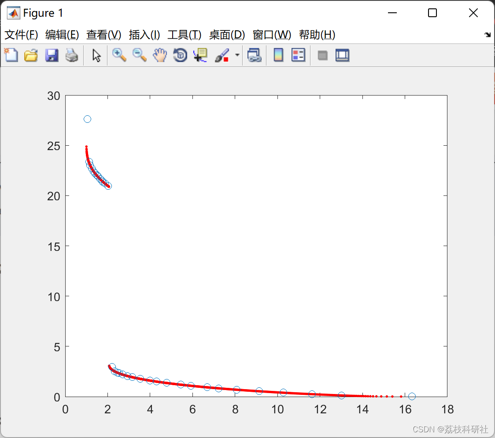
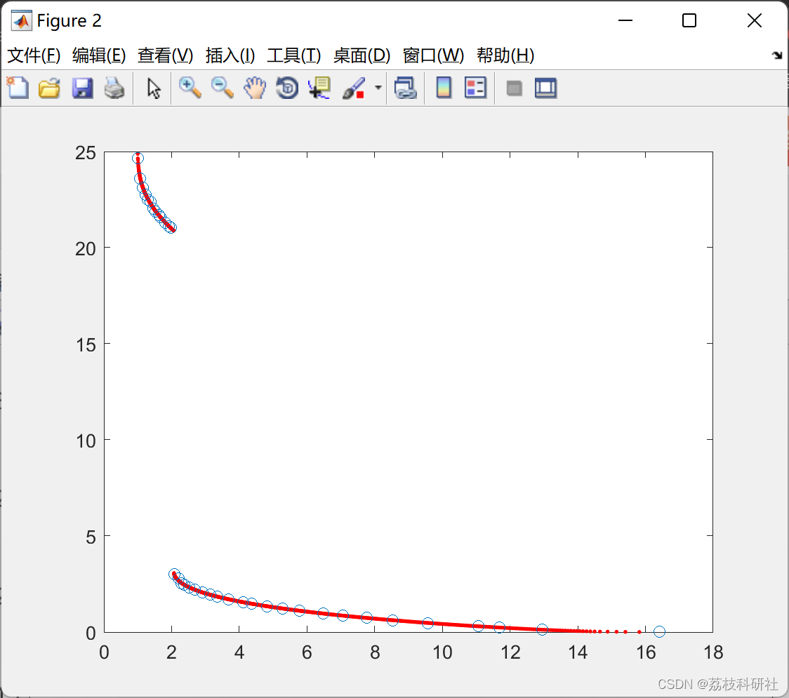

# ev-MOGA Multi-Objective Evolutionary Algorithm (Matlab Code Implementation)

​  
M. Martínez, J.M. Herrero, J. Sanchis, X. Blasco and S. García-Nieto. Applied Pareto multi-objective optimization by stochastic solvers. Engineering Applications of Artificial Intelligence. Vol. 22 pp. 455 - 465, 2009 (ISSN:0952-1976).📚2 Run results​edit
Editor
Part of the code:
🎉3 References
The algorithm is also described in:  
[2] J.M. Herrero, M. Martínez, J. Sanchis and X. Blasco. Well-Distributed Pareto Front by Using the epsilon-MOGA Evolutionary Algorithm. Lecture Notes in Computer Science, 4507, pp. 292-299, 2007. Springer-Verlag. (ISSN: 0302-9743)  
ev-MOGA has been used in:  
[3] J.M. Herrero, X. Blasco, M. Martínez, C. Ramos and J. Sanchis. Robust Identification of a Greenhouse Model using Multi-objective Evolutionary Algorithms. Biosystems Engineering. Vol. 98, Num. 3, pp. 335 - 346, Nov 2007. (ISSN 1537-5110)  
[4] J.M. Herrero, X. Blasco , M. Martínez, J. Sanchis. Multiobjective Tuning of Robust PID Controllers Using Evolutionary Algorithms. Lecture Notes in Computer Science, 4974, pp. 515 - 524, 2008. Springer-Verlag. (ISSN: 0302-9743)  
[5] J. M. Herrero, S. García-Nieto, X. Blasco, V. Romero-García, J. V. Sánchez-Pérez and L. M. Garcia-Raffi. Optimization of sonic crystal attenuation properties by ev-MOGA multiobjective evolutionary algorithm. Structural and Multidisciplinary Optimization. Vol. 39, num. 2, pp. 203 - 215, 2009 (ISSN:1615-1488).  
[6] G. Reynoso, X. Blasco, J. Sanchis. Diseño Multiobjetivo de controladores PID para el Benchmark de Control 2008-2009. Revista Iberoamericana de Automática e Informática Industrial. Vol. 6, Num. 4, pp. 93 - 103 , 2009. (ISSN: 1697-7912)  
[7] E. Afzalan, M. Joorabian. Emission, reserve and economic load dispatch problem with non-smooth and non-convex cost functions using epsilon-multi-objective genetic algorithm variable.  
Electrical Power and Energy Systems 52 (2013) 55–67  
🌈4 Matlab code and detailed article

## Images

<!-- PAYMENT_BLOCK -->

## Get this dataset

- Payment link (Stripe): [Buy now](https://buy.stripe.com/3cs8yP7sY87d0vu9AB)
- Payment QR code: 

<!-- /PAYMENT_BLOCK -->
